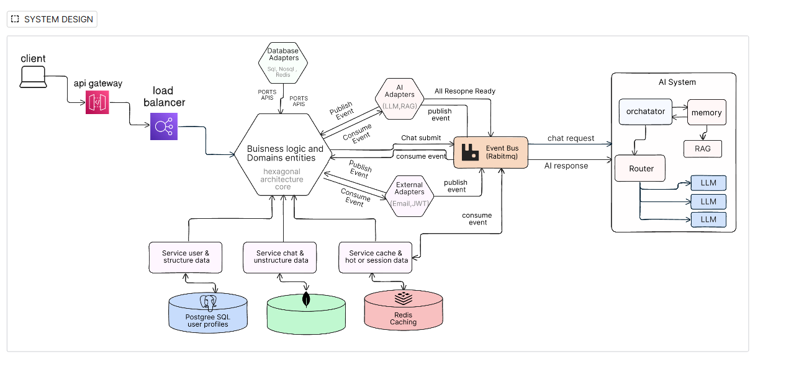
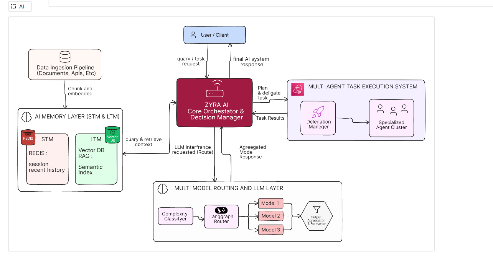
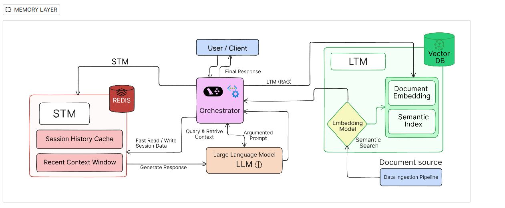
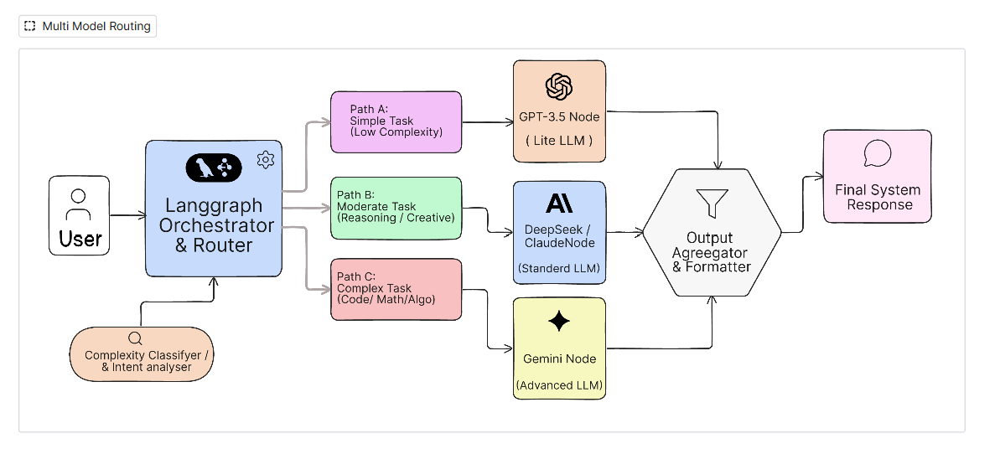
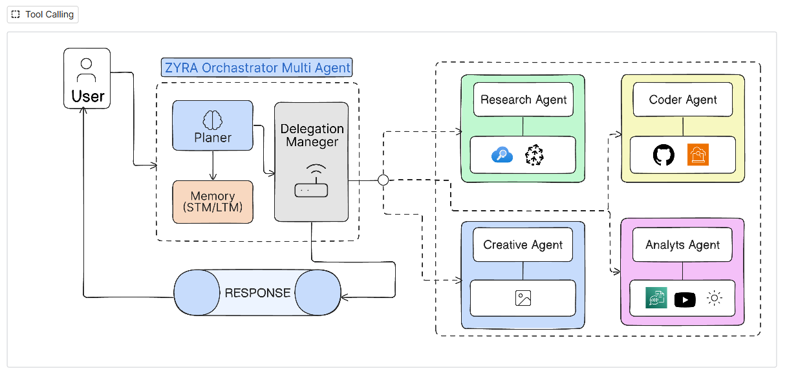
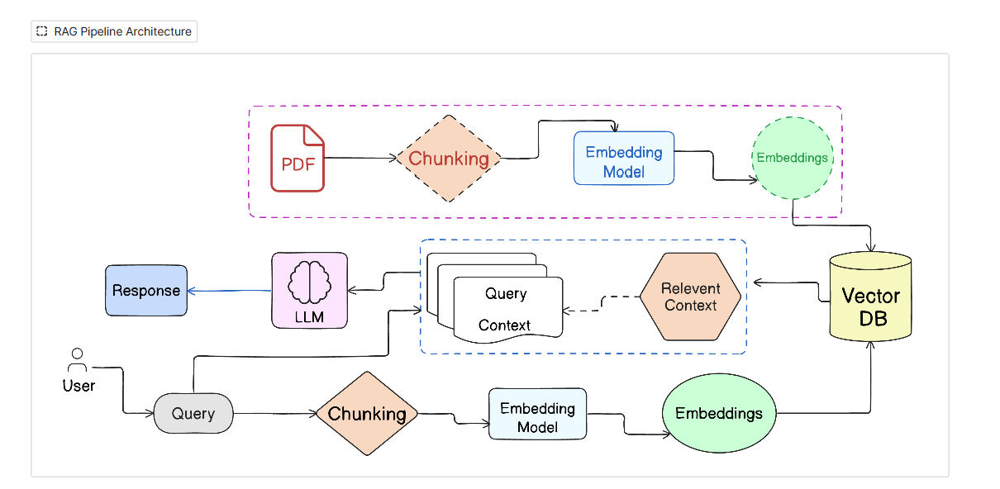
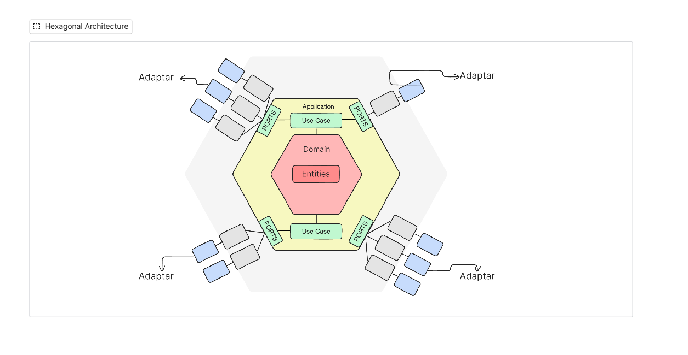

# Zyra AI

+          

  ### One Workspace. Multiple Intelligent Agents.

**Zyra AI** is an intelligent AI workspace designed to bring specialized
AI agents, knowledge retrieval, memory, and task execution together in
one platform.

Instead of relying on a single general-purpose assistant, Zyra is being
developed around specialized agents for research, coding, creativity,
and analysis. An orchestration layer is intended to understand user
requests, select the appropriate agent, and coordinate the work.

Zyra combines a TypeScript backend, Retrieval-Augmented Generation
(RAG), LLM integrations, messaging infrastructure, and a **Modular
Monolith with Hexagonal Architecture**.

> **Our vision: an AI workspace where intelligence doesn't just generate
> answers --- it helps people get things done.**

**Project status:** Active development · Backend-focused

[Repository](https://github.com/Dev-akash77/Zyra-Ai)

------------------------------------------------------------------------

## Contents

-   [Vision](#-vision)
-   [What Zyra Is Building](#-what-zyra-is-building)
-   [Specialized Agents](#-specialized-agents)
-   [System Overview](#-system-overview)
-   [AI Orchestration](#-ai-orchestration)
-   [Memory Architecture](#-memory-architecture)
-   [Multi-Model Routing](#-multi-model-routing)
-   [Tool Calling](#-tool-calling)
-   [RAG Pipeline](#-rag-pipeline)
-   [Backend Architecture](#-backend-architecture)
-   [Technology Stack](#-technology-stack)
-   [Repository Structure](#-repository-structure)
-   [Getting Started](#-getting-started)
-   [Development Status](#-development-status)
-   [Roadmap](#-roadmap)
-   [Contributing](#-contributing)
-   [Team](#-team)

------------------------------------------------------------------------

## 🌍 Vision

  Many AI applications are built around a single interaction: a user
  submits a prompt and a model generates a response. More involved tasks
  often require several capabilities --- research, document retrieval,
  reasoning, external tools, and coordinated execution.
  
  Zyra aims to bring these capabilities into one workspace.
  
  A user should be able to describe what they want to accomplish without
  needing to choose every underlying tool or understand how the system is
  implemented. Zyra's longer-term direction is to interpret the request,
  use relevant context, select suitable models and tools, and involve
  specialized agents where appropriate.
  
  Zyra is intended for a broad audience, including students, developers,
  researchers, analysts, professionals, and entrepreneurs.

## 💡 What Zyra Is Building

The project is organized around four product ideas:

  | Idea | Purpose |
|---|---|
| **Specialized agents** | Give different categories of work dedicated agent capabilities. |
| **Orchestration** | Interpret requests and route work to an appropriate agent. |
| **Contextual knowledge** | Use RAG to retrieve relevant information from uploaded documents. |
| **Tool-based execution** | Allow agents to use external tools and services. |
  ---------------------------------------------------------------------

These capabilities are being developed incrementally. The
development-status section distinguishes working foundations from
ongoing and planned work.

## 🤖 Specialized Agents

The design includes four specialized agent types:

| Agent | Intended Responsibility | Example Capabilities |
|---|---|---|
| **Research Agent** | Research and information gathering | Web/search and knowledge retrieval |
| **Coder Agent** | Programming and technical assistance | GitHub and coding-related tools |
| **Creativity Agent** | Creative thinking and content generation | Image and creative-generation tools |
| **Analyst Agent** | Analysis and insight generation | Data and media-analysis tools |\

The agent ecosystem is under development. The diagram describes the
intended agent organization; it should not be read as a claim that every
agent and tool integration is already complete.

### Future: Agent collaboration

The longer-term design allows the orchestrator to delegate parts of a
complex task to more than one specialized agent, collect their results,
and coordinate a final response.

For example, a research-and-analysis task could involve a Research Agent
gathering information and an Analyst Agent evaluating it. Multi-agent
collaboration is a future capability, not a claim about the current
workflow.

------------------------------------------------------------------------

## 🧭 System Overview

The system-design diagram describes a backend request path with a
client-facing entry point, API gateway, load balancer, business-logic
core, infrastructure adapters, and an event bus.

The following is a simplified interpretation of that design:



```
flowchart LR
    CLIENT[Client] --> API[API Gateway]
    API --> LB[Load Balancer]
    LB --> CORE[Business Logic and Domain Core]

    CORE <--> BUS[RabbitMQ Event Bus]

    CORE <--> DBAD[Database Adapters]
    CORE <--> AIAD[AI Adapters]
    CORE <--> EXTAD[External Adapters]

    DBAD --> DATA[(PostgreSQL / NoSQL / Redis)]
    AIAD --> AISYS[AI System]
    EXTAD --> SERVICES[External Services]

    BUS <--> AISYS

```
The design shows adapters for database technologies, AI/LLM and RAG
integrations, and external services such as email and JWT-related
components. It also depicts services for user/structured data,
chat/unstructured data, and cache/session data.

**Important:** This is a conceptual system-design view. It documents the
intended component relationships and does not imply that every gateway,
load-balancing, adapter, or event-driven workflow shown is already
deployed or complete.

------------------------------------------------------------------------

## 🧠 AI Orchestration

The AI architecture places the **Zyra Core Orchestrator and Decision
Manager** between the user, memory, model-routing layer, and multi-agent
task-execution system.

Its intended responsibilities include:

1.  Receive a user query or task.
2.  Consult relevant conversational or document context.
3.  determine how the request should be handled.
4.  Route the request to an appropriate model or agent.
5.  Delegate work where the task-execution workflow requires it.
6.  Collect results and prepare a response.

### Orchestration and task-execution design

```
flowchart TD
    USER[User / Client] --> ORCH[Zyra Core Orchestrator]
    ORCH <--> MEMORY[AI Memory Layer]
    ORCH <--> ROUTING[Multi-Model Routing and LLM Layer]
    ORCH -->|Plan and delegate task| DELEGATE[Delegation Manager]
    DELEGATE --> AGENTS[Specialized Agent Cluster]
    AGENTS -->|Task results| DELEGATE
    DELEGATE -->|Aggregated results| ORCH
    ORCH --> RESPONSE[Final AI Response]
    RESPONSE --> USER
```

The orchestration and automatic agent-selection workflow is partially
implemented and under active development. The diagram represents the
intended end-to-end design.

------------------------------------------------------------------------

## 🧠 Memory Architecture

The memory design separates short-lived conversational context from
longer-term semantic knowledge.

### Short-Term Memory (STM)

The design uses **Redis** for fast access to session-related
information, including:

-   Session history cache.
-   Recent context window.
-   Fast reads and writes of session data.

### Long-Term Memory (LTM)

The design uses a **Vector Database and RAG** to support semantic
retrieval from indexed documents and knowledge sources.

The intended flow includes document ingestion, embedding generation,
semantic indexing, and retrieval of relevant context.

### Memory flow

```
flowchart TD
    USER[User / Client] <--> ORCH[Orchestrator]

    ORCH <--> STM[Short-Term Memory]
    STM <--> REDIS[(Redis)]
    STM --> HISTORY[Session History and Recent Context]

    SOURCE[Document Sources] --> INGEST[Data Ingestion Pipeline]
    INGEST --> EMBED[Embedding Model]
    EMBED --> INDEX[Semantic Index]
    INDEX <--> VECTOR[(Vector Database)]

    ORCH -->|Query relevant knowledge| VECTOR
    VECTOR -->|Retrieved context| ORCH
    ORCH <--> LLM[Large Language Model]
    ORCH -->|Final response| USER
```

The RAG-based document workflow is implemented. Redis infrastructure is
implemented. The diagram describes the broader STM/LTM design; advanced
persistent conversational memory should be considered a development
direction unless separately confirmed in the implementation.

------------------------------------------------------------------------

## 🔀 Multi-Model Routing

Zyra's design includes a model-routing layer intended to select an LLM
based on the complexity and nature of a request.

The routing diagram describes three conceptual paths:

  | Path | Request Type | Model Category |
|---|---|---|
| **Path A** | Simple, low-complexity tasks | Lightweight Model |
| **Path B** | Moderate tasks, reasoning, or creative work | Standard Model |
| **Path C** | Complex coding, mathematics, or algorithmic tasks | Advanced Model |

A complexity classifier / intent analyser feeds a LangGraph router. The
selected model produces an output that is passed to an aggregator and
formatter before the final response is returned.


``` 
flowchart TD
    USER[User Request] --> CLASSIFIER[Complexity Classifier / Intent Analyser]
    CLASSIFIER --> ROUTER[LangGraph Router]

    ROUTER -->|Simple task| LITE[Lightweight LLM]
    ROUTER -->|Moderate task| STANDARD[Standard LLM]
    ROUTER -->|Complex task| ADVANCED[Advanced LLM]

    LITE --> AGG[Output Aggregator and Formatter]
    STANDARD --> AGG
    ADVANCED --> AGG

    AGG --> RESPONSE[Final System Response]
```

The design illustration names GPT-3.5, DeepSeek / Claude, and Gemini as
examples of model nodes. These are design examples, not a guarantee that
each named model is currently configured or active.

**Status:** Multiple-provider integration is part of the project
direction. Automated complexity-based model routing remains planned /
under development.

------------------------------------------------------------------------

## 🧰 Tool Calling

Tool calling is intended to let agents interact with capabilities beyond
text generation.

The tool-calling design shows a Zyra orchestrator with:

-   **Planner:** Interprets the request and prepares a plan.
-   **Memory:** Supplies relevant short-term and long-term context.
-   **Delegation Manager:** Coordinates task delegation.
-   **Specialized agents:** Handle work within their areas.


``` 
flowchart TD
    USER[User] --> PLANNER[Planner]
    PLANNER <--> MEMORY[Memory: STM / LTM]
    PLANNER --> DELEGATION[Delegation Manager]

    DELEGATION --> RESEARCH[Research Agent]
    DELEGATION --> CODER[Coder Agent]
    DELEGATION --> CREATIVE[Creativity Agent]
    DELEGATION --> ANALYST[Analyst Agent]

    RESEARCH --> RESULTS[Agent Results]
    CODER --> RESULTS
    CREATIVE --> RESULTS
    ANALYST --> RESULTS

    RESULTS --> DELEGATION
    DELEGATION --> RESPONSE[Response]
    RESPONSE --> USER
```

The basic tool-calling foundation has been built. Specialized-agent
implementation, integration, and the complete delegation workflow are
still being developed.

The design associates agents with different tool categories, such as
search and knowledge tools for research, GitHub and coding tools for
coding, creative/image tools for creativity, and data or media tools for
analysis. Individual integrations should be treated as available only
when confirmed in the codebase.

------------------------------------------------------------------------

## 📚 RAG Pipeline

Zyra includes an implemented document-based Retrieval-Augmented
Generation pipeline.

RAG lets the system retrieve relevant information from user-provided
documents and supply that context to an LLM when generating an answer.

### 1. Document ingestion and indexing

The supplied RAG design shows a PDF moving through chunking and
embedding generation before its vectors are stored in a vector database.

``` 
flowchart LR
    PDF[PDF Document] --> CHUNK[Chunking]
    CHUNK --> EMBED[Embedding Model]
    EMBED --> VECTORS[Document Embeddings]
    VECTORS --> DB[(Vector Database)]
```

### 2. Query and retrieval

A user query is embedded and used to retrieve relevant document context
from the vector database. The retrieved context is then passed to the
LLM to help generate the response.

``` 
flowchart TD
    USER[User Question] --> QUERY[Query]
    QUERY --> QCHUNK[Query Processing / Chunking]
    QCHUNK --> QEMBED[Embedding Model]
    QEMBED --> SEARCH[Vector Similarity Search]
    DB[(Vector Database)] <--> SEARCH
    SEARCH --> CONTEXT[Relevant Context]
    CONTEXT --> LLM[LLM]
    LLM --> RESPONSE[Response]
```

### RAG components

-   **Document ingestion:** Accepts documents as a knowledge source.
-   **Chunking:** Divides content into smaller sections.
-   **Embedding model:** Converts text into vector representations.
-   **Vector database:** Stores embeddings for retrieval.
-   **Semantic search:** Finds context relevant to a user query.
-   **LLM generation:** Uses retrieved context to formulate an answer.

**Current implementation:** The document-based RAG workflow and Pinecone
integration have been confirmed as implemented by the team.

------------------------------------------------------------------------

## 🏛️ Backend Architecture

Zyra uses a **Modular Monolith with Hexagonal Architecture (Ports &
Adapters)**.

These are complementary architectural ideas:

-   **Modular Monolith** describes how the application is organized:
    functional modules live within a unified backend application.
-   **Hexagonal Architecture** describes how application and domain
    logic are isolated from infrastructure and external dependencies.

### Hexagonal Architecture

The supplied Hexagonal Architecture diagram places domain entities at
the centre, surrounded by application use cases. Ports define the
boundaries through which the application communicates with external
systems; adapters implement those boundaries.



``` 
flowchart TB
    subgraph OUTSIDE["External Systems and Adapters"]
        INAD[Inbound Adapters]
        OUTAD[Outbound Adapters]
    end

    subgraph CORE["Application Core"]
        PORTIN[Input Ports]
        APP[Application Layer / Use Cases]
        DOMAIN[Domain Layer]
        ENTITIES[Domain Entities]
        PORTOUT[Output Ports]

        PORTIN --> APP
        APP --> DOMAIN
        DOMAIN --> ENTITIES
        APP --> PORTOUT
    end

    INAD --> PORTIN
    PORTOUT --> OUTAD
```

### Why this approach?

-   **Separation of concerns:** Domain rules are not tied to
    infrastructure details.
-   **Dependency inversion:** Core application logic depends on
    contracts, not concrete providers.
-   **Replaceable adapters:** External integrations can be changed
    behind stable interfaces.
-   **Testability:** Use cases and domain logic can be tested
    independently of infrastructure.
-   **Extensibility:** New providers and integrations can be added
    without spreading provider-specific code throughout the application.

The team is applying these principles as the agent architecture evolves.

------------------------------------------------------------------------

## 🛠️ Technology Stack

The following technologies are part of the project's described stack:

| Area | Technology | Role |
|---|---|---|
| Backend Framework | NestJS | Backend application and modules |
| Language | TypeScript | Application development |
| AI Orchestration | LangChain | LLM and tool integration |
| Agent Workflows | LangGraph | Graph-based orchestration and routing |
| Relational Database | PostgreSQL | Structured application data |
| ORM | Drizzle ORM | Database schema and queries |
| Cache / Session Infrastructure | Redis | Fast-access and session-related data |
| Message Broker | RabbitMQ | Event and message transport |
| Vector Database | Pinecone | Semantic retrieval for RAG |
| Authentication | JWT, Passport | Authentication |
| Containerization | Docker | Containerized development environment |
| LLM Integrations | Multiple Providers | Model access |

Specific provider versions, model names, and production deployment
details should be documented when they are confirmed in the repository
configuration.

------------------------------------------------------------------------

## 📁 Repository Structure

The public repository contains these top-level areas:

``` text
Zyra-Ai/
├── server/       # Backend application
├── client/       # Client-side project area
├── docs/         # Project documentation
└── README.md
```

**Current development focus: `server/`.** A completed frontend
application is not currently available.

The detailed internal backend tree should be documented here as the
server modules and adapters stabilize.

------------------------------------------------------------------------

## 🚀 Getting Started

Zyra is currently backend-focused, and Docker Compose is the team's
primary way to run the application and its supporting infrastructure.

### Prerequisites

-   [Git](https://git-scm.com/)
-   [Docker](https://www.docker.com/)
-   Docker Compose (included with current Docker Desktop installations)

### 1. Clone the repository

``` bash
git clone https://github.com/Dev-akash77/Zyra-Ai.git
cd Zyra-Ai
```

### 2. Configure environment variables

Review the environment configuration expected by the backend and Docker
Compose files.

Depending on the enabled services, configuration may include:

-   PostgreSQL connection details
-   Redis connection details
-   RabbitMQ connection details
-   Pinecone credentials and index configuration
-   LLM provider API keys
-   JWT authentication secrets

Use the environment template or setup instructions present in the
repository. Do not commit real credentials or API keys.

### 3. Start the containers

Run the command from the directory containing the relevant Compose file:

``` bash
docker compose up -d --build
```

### 4. Check container status

``` bash
docker compose ps
```

### 5. Follow logs

``` bash
docker compose logs -f
```

### 6. Stop the containers

``` bash
docker compose down
```

If the Compose file is inside a subdirectory, run these commands from
that directory or specify its path with `-f`.

------------------------------------------------------------------------

## 🤝 Contributing

Zyra is an evolving project. We welcome developers interested in AI
engineering, backend development, agentic systems, and software
architecture.

To contribute:

1.  Explore the repository and its documentation.
2.  Understand the existing modules and architecture.
3.  Look for an existing issue or propose a focused improvement.
4.  Discuss significant changes with the team before starting
    implementation.
5.  Submit a pull request describing the change and how it was tested.

Please avoid committing secrets, credentials, generated files, or
unrelated changes.

------------------------------------------------------------------------

## 👥 Team

Zyra AI is being developed collaboratively by a team of six.

We are exploring the intersection of AI application engineering, backend
architecture, retrieval systems, and autonomous agents through hands-on
product development.

**Repository:**
[Dev-akash77/Zyra-Ai](https://github.com/Dev-akash77/Zyra-Ai)

------------------------------------------------------------------------

## 🌱 Our Vision

We believe the future of AI is not limited to generating answers.

It is about understanding problems, accessing relevant knowledge,
choosing the right tools, and coordinating work to produce useful
outcomes.

Zyra is our attempt to move toward that future --- one architectural
decision, one capability, and one iteration at a time.

**One Workspace. Multiple Intelligent Agents. Endless Possibilities.**

------------------------------------------------------------------------

⭐ If you find Zyra interesting, consider starring the repository and
following its development.
